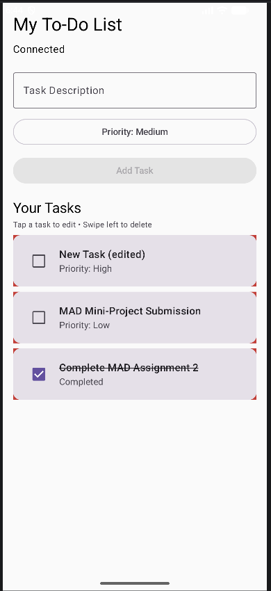
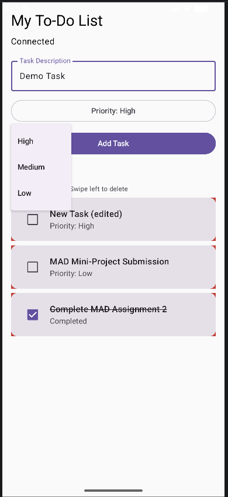
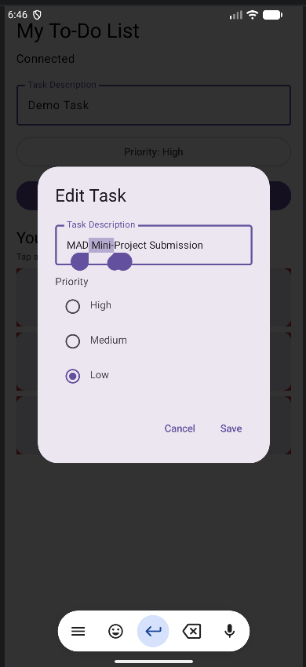
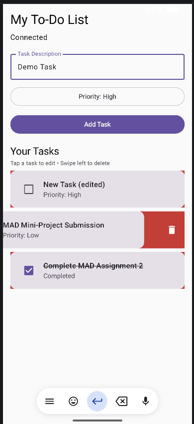
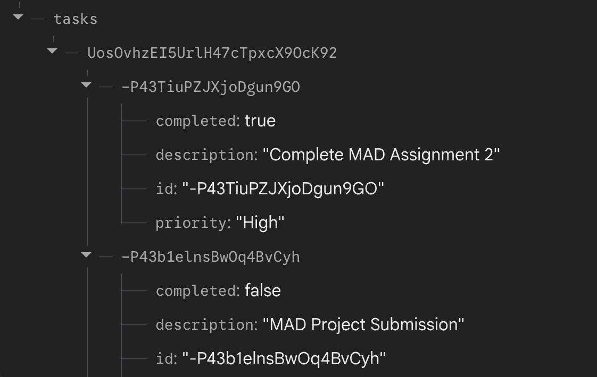

# Firebase To-Do List App

A simple Android To-Do List app built using **Kotlin, Jetpack Compose, and Firebase Realtime Database** for my Mobile Application Development (MAD) assignment.

The app helps users organize their tasks based on priority, keep track of completed work, and manage their to-do list. All tasks are stored in Firebase, so changes are saved and reflected in real time.

## Features

- **Add Tasks:** Create new tasks with a description and set their priority as High, Medium, or Low.
- **View Tasks:** See all your tasks in a list, automatically arranged by priority.
- **Edit Tasks:** Tap on any task to change its description or priority.
- **Delete Tasks:** Swipe left on a task to delete it.
- **Mark as Completed:** Use the checkbox beside a task to mark it as done.
- **Task Sorting:** Pending tasks appear first, sorted from High to Low priority. Completed tasks move to the bottom.
- **Real-Time Updates:** Any changes made to tasks are automatically reflected in the app using Firebase.
- **Task Storage:** Tasks are saved in Firebase, so they aren't lost when the app is closed.

## Tech Stack

| Technology | Used For |
|---|---|
| Kotlin | Writing the Android app |
| Jetpack Compose | Building the user interface |
| Material 3 | UI components like buttons, cards, and dialogs |
| Firebase Realtime Database | Storing and updating tasks |
| Firebase Authentication | Anonymous user authentication |
| Android Studio | Developing and testing the app |
| Gradle | Managing dependencies |

## How the App Works

When the app opens, Firebase anonymously authenticates the user, allowing them to use the app without having to sign up or log in.

Users can enter a task description, choose a priority, and add it to their list. The task is then saved in Firebase Realtime Database.

The app uses a `ValueEventListener` to listen for database changes and automatically refresh the task list whenever something is added, edited, or deleted.

Tasks are arranged based on their priority, with incomplete tasks shown first. Users can also mark tasks as completed, which crosses them out and moves them to the bottom of the list.

## Firebase Database Structure

Tasks are stored under each user's unique Firebase ID (UID).

```text
tasks/
└── userUID/
    └── taskID/
        ├── id: "taskID"
        ├── description: "Complete MAD Assignment"
        ├── priority: "High"
        └── completed: false
```

The `completed` field stores whether a task is finished (`true`) or still pending (`false`).

## Getting Started

### Requirements

- Android Studio
- Android SDK (minimum API 24)
- Firebase project
- Android emulator or physical Android device
- Internet connection

### Setup Instructions

1. Clone the repository:

   ```bash
   git clone https://github.com/ria-on-git/To-Do-List-Firebase.git
   ```

2. Open the project in Android Studio.

3. Create a Firebase project at [Firebase Console](https://console.firebase.google.com/).

4. Register an Android app using the package name `com.c055.c055_assignment2`.

5. Download the `google-services.json` file and place it in the `app/` folder.

6. Enable **Anonymous Authentication** under Firebase Authentication.

7. Create a **Firebase Realtime Database**.

8. In the database's Rules tab, add the following rules:

   ```json
   {
     "rules": {
       "tasks": {
         "$uid": {
           ".read": "auth != null && auth.uid === $uid",
           ".write": "auth != null && auth.uid === $uid"
         }
       }
     }
   }
   ```

9. Copy your Firebase Realtime Database URL and update the `databaseUrl` variable in `MainActivity.kt`.

10. Sync Gradle and run the app.

## Using the App

Once the app is running:

1. **Add a task:** Enter the task description, choose its priority, and tap Add Task.
2. **Edit a task:** Tap on a task to open the edit dialog and make changes.
3. **Complete a task:** Check the box beside a task to mark it as done. Uncheck it to mark it as pending again.
4. **Delete a task:** Swipe left on a task to remove it.

## What It Looks Like

### Main Screen


### Adding a Task


### Editing a Task


### Swipe to Delete


### Firebase Database


## What I Learned

Through this assignment, I learned how to connect an Android app to Firebase Realtime Database and use it to perform CRUD (Create, Read, Update, Delete) operations.

I also got to work with Jetpack Compose components like `LazyColumn`, `AlertDialog`, `Checkbox`, and `SwipeToDismissBox` to make the app more interactive.

Apart from the basic CRUD operations, I implemented priority-based sorting, task completion tracking, and Firebase Anonymous Authentication to manage tasks separately for each user.

